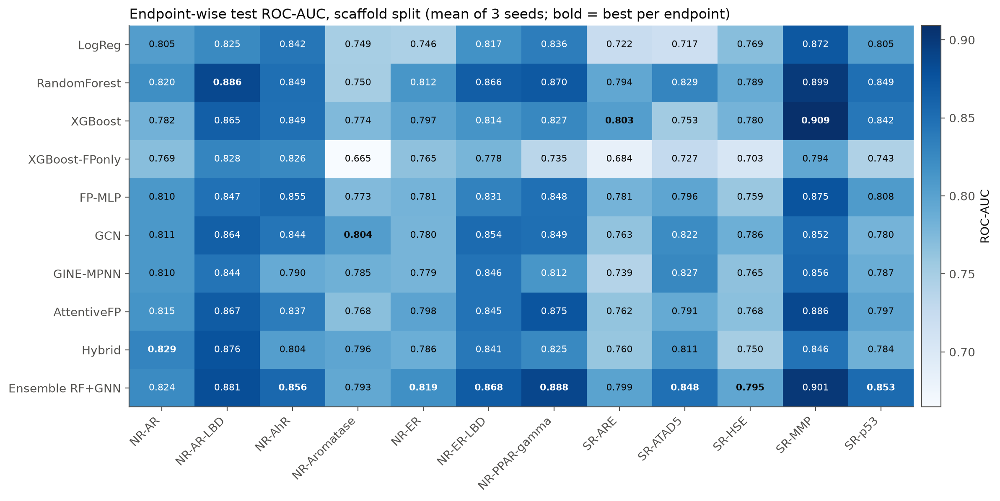
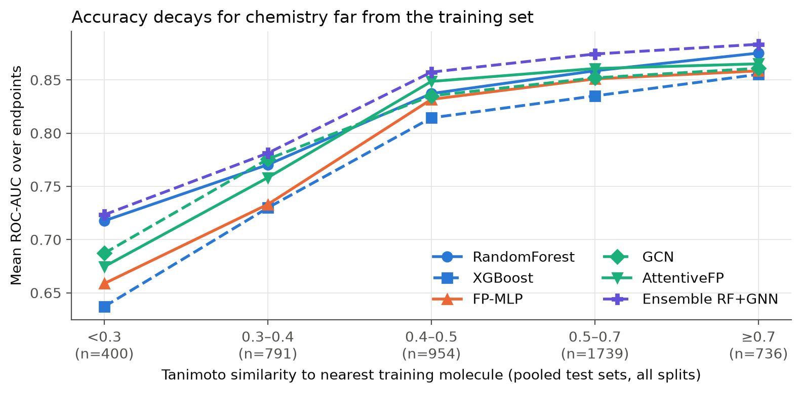
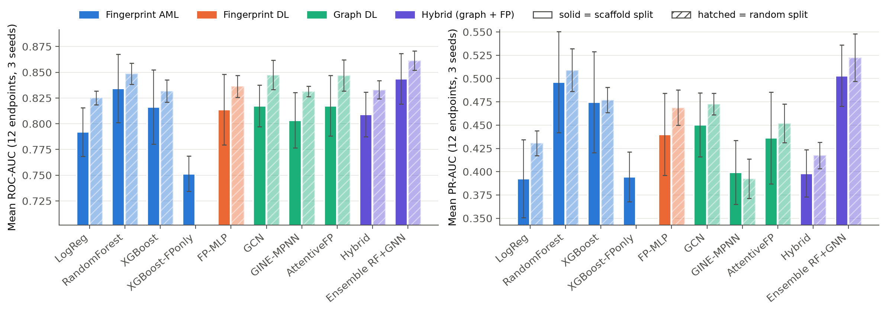
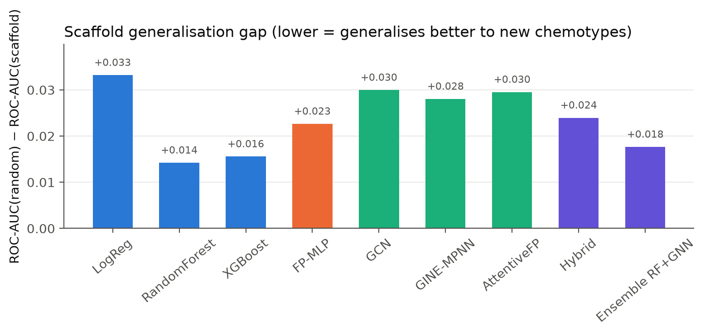

# Molecular Toxicity Prediction via Fingerprints and Molecular Graph Networks

**AML / DL Group Project 8.** Tox21 (MoleculeNet): ~7.8k compounds, 12 toxicity endpoints.

> Do learned molecular-graph representations (message passing networks) predict toxicity better than
> engineered chemical fingerprints, especially for chemical families **unseen** during training?

The full write-up, with every table and figure, is in
[`notebooks/Tox21_Toxicity_Report.ipynb`](notebooks/Tox21_Toxicity_Report.ipynb).

An HTML export is in [`report/Tox21_Toxicity_Report.html`](report/Tox21_Toxicity_Report.html).

## Key results

Test-set mean over 12 endpoints, mean ± std over 3 split seeds. Missing labels are excluded per endpoint.

| Model | Family | Scaffold ROC-AUC | Scaffold PR-AUC | Random ROC-AUC | Gap |
|---|---|---|---|---|---|
| Logistic Regression | Fingerprint AML | 0.792 ± 0.024 | 0.393 ± 0.042 | 0.825 | 0.033 |
| **Random Forest** | Fingerprint AML | **0.834 ± 0.033** | **0.496 ± 0.054** | 0.849 | **0.014** |
| XGBoost | Fingerprint AML | 0.816 ± 0.036 | 0.475 ± 0.054 | 0.832 | 0.016 |
| XGBoost (FP only, ablation) | Fingerprint AML | 0.751 ± 0.017 | 0.394 ± 0.027 | – | – |
| FP-MLP (multitask) | Fingerprint DL | 0.814 ± 0.034 | 0.440 ± 0.044 | 0.836 | 0.023 |
| GCN | Graph DL | 0.817 ± 0.020 | 0.450 ± 0.034 | 0.847 | 0.030 |
| GINE-MPNN | Graph DL | 0.803 ± 0.027 | 0.399 ± 0.034 | 0.832 | 0.028 |
| AttentiveFP | Graph DL | 0.818 ± 0.029 | 0.436 ± 0.049 | 0.847 | 0.030 |
| Hybrid (GINE + FP, end-to-end) | Hybrid | 0.809 ± 0.022 | 0.398 ± 0.025 | 0.833 | 0.024 |
| **Ensemble RF + GNN** | Hybrid | **0.844 ± 0.025** | **0.503 ± 0.033** | **0.861** | 0.018 |

**Findings**
1. **Fingerprints + descriptors with a Random Forest are the strongest single model** on unseen scaffolds.
   RF is significantly better than every GNN (paired Wilcoxon, p < 0.005). The GNNs are statistically tied
   with XGBoost and with a deep fingerprint MLP.
2. **The representations are complementary.** GNNs win endpoints such as NR-Aromatase. A validation-weighted RF +
   GNN late fusion is the best model overall (better than RF on 26/36 endpoint × seed pairs, p = 0.001), and the
   validation-chosen weights put ~46% on the graph model.
3. **GNNs generalise worse to new chemotypes.** Their random → scaffold drop (≈ 0.03) is about twice RF's
   (0.014). On random splits GCN and AttentiveFP tie RF. Part of their random-split performance is
   interpolation between close analogues.
4. **All models fail on truly novel chemistry.** ROC-AUC falls from ~0.87 (Tanimoto ≥ 0.7 to the nearest training
   molecule) to ~0.65–0.72 (< 0.3).
5. **Physicochemical descriptors matter.** Removing them costs XGBoost 0.065 ROC-AUC.

| | |
|---|---|
|  |  |
|  |  |

## Method at a glance

| Stage | What we did |
|---|---|
| **Data** | RDKit parse → cleanup → largest organic fragment (salt stripping) → canonical SMILES. **Deduplicated before splitting** (137 duplicate rows merged; conflicting labels set to missing). Missing labels kept as `NaN` and masked. |
| **Splits** | Randomised Bemis–Murcko **scaffold split** 80/10/10 × 3 seeds (zero scaffolds shared between train and test). The same models are also run on random splits × 3 seeds to measure the generalisation gap. All models see identical split files. |
| **AML baseline** | Morgan/ECFP4 (r=2, 2048 bits) + 217 RDKit descriptors (train-only scaling). **One model per endpoint**: Logistic Regression, Random Forest, XGBoost. Per-endpoint class weights. Grid search on validation ROC-AUC. Ablation: XGBoost on fingerprints only. |
| **DL models** | Atoms = nodes (56-d features), bonds = edges (12-d features). **GCN**, **GINE-MPNN** (bond-aware message passing), **AttentiveFP**. Multitask (12 outputs) with a **masked, class-weighted BCE**: missing labels contribute zero loss. Early stopping on validation ROC-AUC. |
| **Controls / hybrids** | **FP-MLP**: same fingerprints, deep multitask, which isolates "deep multitask" from "graph representation". **Hybrid**: GINE embedding + fingerprint branch with modality dropout. **Ensemble RF+GNN**: validation-weighted rank fusion. |
| **Evaluation** | Endpoint-wise **ROC-AUC** and **PR-AUC** on the test set, **excluding missing labels per endpoint**. Mean ± std over 3 seeds. Paired Wilcoxon tests. Random-vs-scaffold gap. AUC as a function of the Tanimoto similarity to the nearest training molecule. |

## Repository layout

```
src/
  config.py      paths, endpoint names, split settings
  data.py        cleaning, canonicalisation, dedup, label merging, scaffold / random splits
  features.py    Morgan FP, RDKit descriptors (+ train-only scaler), molecular graphs
  metrics.py     endpoint-wise ROC-AUC / PR-AUC that skip missing labels
  baselines.py   LogReg / RF / XGBoost per endpoint
  gnn.py         FP-MLP, GCN, GINE-MPNN, AttentiveFP, Hybrid + masked-loss training loop
  ensemble.py    late-fusion RF + GNN (weights chosen on validation)
  analysis.py    tables, Wilcoxon tests, generalisation analysis, all figures
notebooks/
  Tox21_Toxicity_Report.ipynb   the report (executed)
  build_notebook.py             regenerates the notebook
results/   metrics CSVs, chosen hyper-parameters, per-split test predictions (preds/)
figures/   fig1–fig8 used in the report
data/      raw download + processed cache (clean CSV, split indices, features)
```

## Reproduce

```bash
./run_all.sh
```

This creates a Python 3.12 venv with `uv`, downloads Tox21 and runs every stage. It takes about 2 h on an
8-core laptop CPU, and no GPU is needed. Individual stages:

```bash
.venv/bin/python -m src.data          # clean + split
.venv/bin/python -m src.baselines     # AML models
.venv/bin/python -m src.gnn --seeds 0 # DL models for one split seed
.venv/bin/python -m src.ensemble      # late fusion
.venv/bin/python -m src.analysis      # tables + figures
```

## References

Wu et al. (2018) *MoleculeNet*, Chem. Sci. · Rogers & Hahn (2010) *ECFP* · Bemis & Murcko (1996) ·
Kipf & Welling (2017) *GCN* · Gilmer et al. (2017) *MPNN* · Hu et al. (2020) *GINE* ·
Xiong et al. (2019) *AttentiveFP* · Yang et al. (2019) *Chemprop* · Chen & Guestrin (2016) *XGBoost*.
